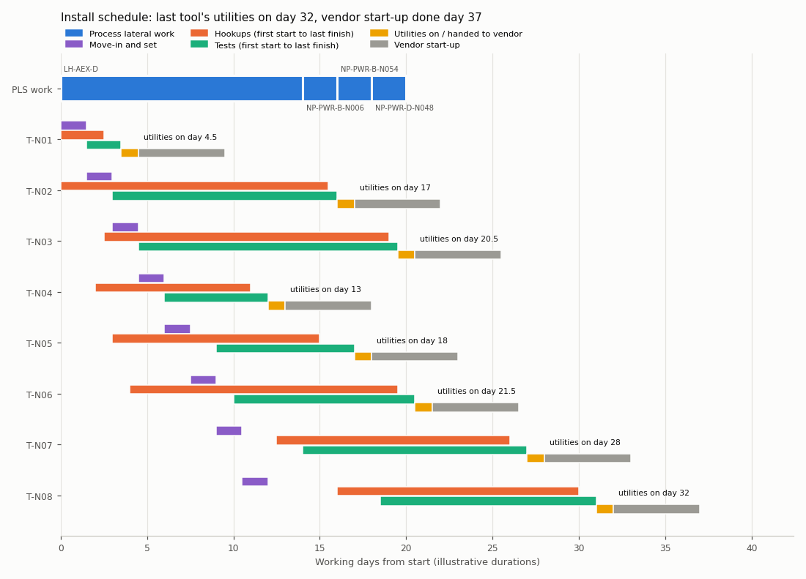

# tool-hookup-planner

Planning the install ("hookup") of semiconductor process tools on a BIM model of a
sub-fab: check utility header capacity, assign each tool utility to a point of
connection (POC), route the hookups in 3-D around columns, headers and earlier routes,
size the lines against velocity and pressure-drop limits, detect clashes, and produce
the hookup list, material take-off, cost estimate, schedule and an IFC file of the new
routes. A SQLite utilities database sits underneath, populated from the IFC model, and a
review aid checks hookup proposals for common classes of drawing errors.

> **Illustrative data only.** The sub-fab, utilities, tools, capacities, pressures,
> unit rates and durations are synthetic, generated from `data/scenario.json` and
> `data/unit_rates.json`. They do not describe any real fab, company, tool or vendor.
> Costs are in a notional currency unit (CU). Engineering rules and constants are cited
> in [docs/sources.md](docs/sources.md); everything not listed there is an
> illustrative modelling choice.

Terms used below: the sub-fab *headers* (mains) run along the corridors; *process lateral*
(PLS) work extends them to points of connection (here: header capacity steps and new
POCs); a *hookup* runs from a POC to the tool's connection point; after the hookups are
tested, utilities are turned on and the tool is handed to the vendor for start-up.

## What it does

| Step | Module | Output in `results/` |
|---|---|---|
| Synthetic sub-fab: 7 × 4 bays, 40 columns, 18 headers (PCW supply/return, UPW, CDA, N2, general/acid/solvent exhaust, power busbar), 252 POCs, 14 existing tools with as-built hookups, 8 new tools | `scenario.py` | – |
| IFC4 model (IfcOpenShell): grid, columns, headers as IfcPipeSegment / IfcDuctSegment / IfcCableSegment with property sets (values carry units), POCs, tool footprints on the fab level, existing hookups, distribution ports linking header → POC → hookup → tool; read back into the database | `ifc_io.py`, `db.py` | `subfab_base.ifc`, `roundtrip.json`, `db/*.csv` |
| Capacity check of the new tools against remaining header capacity, header capacity steps and cost | `capacity.py` | `capacity_check.csv`, `capacity_sensitivity.csv` |
| POC assignment as a MILP (scipy/HiGHS) with header capacity, capacity steps, optional new POCs and PCW supply/return pairing; greedy baseline; Hungarian cross-check | `assign.py` | `assignment.json`, `assignment.csv` |
| A* routing on a 0.6 m lattice with bend penalty, line sizing (Darcy–Weisbach + Swamee–Jain, elbow/tee/valve losses, static head relative to the ambient air, PCW loop pressure, velocity limits, breaker current), clash detection | `lattice.py`, `hydraulics.py`, `geometry.py`, `planner.py` | `hookup_list.csv/.md`, `routing_summary.json`, `clashes_*.csv` |
| Material take-off, cost estimate, resource-constrained schedule and Gantt chart | `costing.py`, `schedule.py` | `mto.csv`, `cost_estimate.csv`, `cost_summary.json`, `schedule.csv`, `gantt.png` |
| IFC with the planned routes and planned POCs | `ifc_io.py` | `subfab_with_hookups.ifc` |
| Drawing review aid and its fault-injection tests | `review.py` | `review_clean.md`, `review_demo.md`, `review_eval.md/.json` |

How each step works, and what it simplifies, is in [docs/method.md](docs/method.md).

## Reproduce

```bash
python -m venv .venv && . .venv/bin/activate      # Windows: .venv\Scripts\activate
pip install -r requirements.txt
python -m pytest -q                               # unit tests
python scripts/run_all.py                         # regenerates every file in results/ (2-3 minutes)
python scripts/verify_readme.py                   # every number below is read back from results/
python tests/mutate.py --jobs 4                   # mutation check (the report does not depend on --jobs)
```

The command-line interface works on the database:

```bash
PYTHONPATH=src python -m hookup_planner build-db                  # synthetic model -> IFC -> SQLite
PYTHONPATH=src python -m hookup_planner query headers --system AEX
PYTHONPATH=src python -m hookup_planner capacity --reserve 0.1
PYTHONPATH=src python -m hookup_planner run                       # same as scripts/run_all.py
PYTHONPATH=src python -m hookup_planner review results/proposal.json   # after `run`
```

Results are deterministic: floats are rounded to 10 significant digits, IFC GlobalIds and
timestamps are fixed, the MILP optimum is made unique. `results/MANIFEST.sha256` (34
files; the PNG is hashed by its decoded pixels) was identical on Windows 11 and on
Ubuntu 24.04 under WSL with the pinned versions in `requirements.txt`, and CI regenerates
the results on ubuntu-latest and compares the manifest.

## Results (synthetic demo)

All numbers come from `results/` and are checked by `scripts/verify_readme.py`.

**Model and database.** Seed → IFC → read-back → SQLite → read-back reproduces the
seed exactly (`roundtrip.json`: ifc_equals_seed **true**, db_equals_seed **true**).
Following the IFC distribution ports from every hookup and POC leads to the POC, tool and
header named in its property set (0 mismatches over 88 hookups and 252 POCs). Both IFC
files pass the IfcOpenShell validator with EXPRESS rules switched on (0 issues).

**Capacity.** The 8 new tools need 52 connections. At the system level only acid
exhaust is short: AEX new load 3371 m³/h against 2452 m³/h remaining
(`capacity_check.csv`). PCW supply is nominally fine but has a 2 L/min margin (99.75 %
utilised), which matters at header level below. With a planning reserve the picture
changes quickly (`capacity_sensitivity.csv`):

| Reserve | Systems short | Capacity steps (MILP) | Step cost (MILP) |
|---|---|---|---|
| 0 % | 1 | 1 | 95,000 CU |
| 2 % | 2 | 2 | 180,000 CU |
| 5 % | 2 | 2 | 180,000 CU |
| 10 % | 3 | 4 | 350,000 CU |
| 20 % | 4 | 6 | 470,000 CU |

**Assignment** (`assignment.json`). The MILP assigns each tool's PCW supply and return to
the same corridor. Without that pairing rule the optimum would split 3 of the 6 PCW
tools across corridors; pairing costs 9,360 CU. Most new power loads need a large breaker
under the 125 % rule and there are too few large free breakers within reach, so the
existing-POC-only MILP leaves 3 requirements unserved (all PWR); allowing new POCs serves
all 52.

| Method (0 % reserve) | Hookup cost (est.) | Capacity steps | Total |
|---|---|---|---|
| MILP | 148,338 CU | AEX-D ×1 | **243,338 CU** |
| Greedy (cheapest free POC, step when short) | 131,502 CU | AEX-D ×1, PCWS-C ×1 | 311,502 CU |

How much the MILP saves against the greedy rule depends on the planning reserve:
21.9 % at 0 %, 34.2 % at 10 %, and between 21.9 % and 42.1 % over the 5 reserves in
`capacity_sensitivity.csv`. Almost all of it is avoided header capacity steps, whose
costs are invented: at 0 % reserve the greedy rule loads PCWS-C past its capacity, while
the MILP spends 16,836 CU more on longer hookups to stay inside it. With the capacity and
pairing rows removed, the MILP and `linear_sum_assignment` give the same optimum
(126,498 CU), and unit tests compare the MILP with brute-force enumeration on small
instances, with and without the pairing rule.

**Routing and sizing** (`routing_summary.json`, `hookup_list.csv`). All 52 hookups
routed, 628.8 m in total, 1.35 % above the Manhattan lower bound (620.4 m), 199 bends.
**0 clashes** against columns, headers, support equipment, the 88 existing hookups and each
other. The same assignments drawn as straight Manhattan L-routes that ignore obstacles
(a sanity baseline, not a competing method) produce 402 clashes on 44 of the 52 hookups.
Line sizes are governed by the velocity limit for 40 hookups, by the pressure budget for
4 (PCW supply and UPW hookups whose tools need high inlet pressure) and by the breaker
rule for 8 power hookups. Every hookup passes its velocity, pressure and gas-validity
checks. The static term uses the density difference to the surrounding air, so the 14
exhaust hookups lose 0.034 to 0.153 kPa (friction and fittings; the static term is at most
0.0006 kPa). Each PCW return is checked as part of its loop (supply header − supply loss −
tool pressure drop − return loss ≥ return header); the smallest loop margin is 23.7 kPa.
2 of the 14 exhaust hookups run below 1000 ft/min (see limitations).

**Cost and schedule** (`cost_summary.json`, `schedule_summary.json`, `gantt.png`).
Estimate 274,730 CU: hookups 161,730 CU, process lateral work 113,000 CU (one AEX header
capacity step and three new breakers). 132 tasks; with 3 pipe crews, 1 duct crew, 1
electrical crew, 2 test teams, 1 PLS crew and 1 rigging crew, the last tool has its
utilities turned on (handed to the vendor) on day 32, and vendor start-up of the last
tool ends on day 37 (durations illustrative).



**Review aid** (`review_clean.md`, `review_demo.md`, `review_eval.md`). The planner's own
proposal gets 0 findings. Two fault-injection tests follow, one fault at a time.

*Check-coverage test (faults constructed to violate each rule).* Each fault was written
to break one specific rule, so detection is expected by construction; this only shows
that every check is wired up, not how well the review aid would do on real drawings. It
also shares the planner's hydraulic and clash code (see limitations).

| Fault | Cases | Expected rule fired | Other findings on the faulted hookups |
|---|---|---|---|
| wrong utility at the POC | 8 | 8 | route disconnected 8, hard clash 8, POC over rating 1 |
| undersized line | 8 | 8 | – |
| clash (detour through a column) | 8 | 8 | pressure 1 |
| POC over rating | 8 | 8 | route disconnected 8, hard clash 6, header over capacity 3 |
| header over capacity (declared step removed) | 2 | 2 | – |
| duplicate POC | 8 | 8 | route disconnected 8, hard clash 4, header over capacity 2, POC over rating 1 |
| disconnected route | 8 | 8 | – |
| PCW return on the other corridor | 6 | 6 | route disconnected 6, hard clash 6 |

Only 2 header-over-capacity cases exist, because only one header (AEX-D) relies on a
declared step. Findings on hookups that were not touched are either explained by the
fault (a clash with the faulted run, a header whose load the fault changed, the PCW partner
of a faulted hookup: 40 in total) or unexplained (0).

*Faults not targeted by any rule*, written after the checks; a case counts as caught if
any finding lands on a faulted hookup:

| Fault | Cases | Caught | Checks that fired |
|---|---|---|---|
| flow in L/min read as m³/h when sizing (line oversized) | 8 | **0** | none |
| flow in m³/h read as L/min when sizing (line undersized) | 8 | 8 | velocity 8, pressure 5, gas validity 1 |
| gas line with a loss over 10 % of inlet pressure | 2 | 2 | gas validity, pressure, velocity |
| PCW supply and return swapped at the tool | 6 | 6 | route disconnected, hard clash |
| route ending at another tool | 8 | 8 | route disconnected, hard clash |

The review aid has no check that a line is larger than its POC or than needed, so a
unit error that oversizes the line goes through unnoticed. Only 2 of the 16 gas hookups
can be pushed past the 10 % limit by drawing a smaller catalogue tube, hence 2 cases.

**Tests.** The suite has 98 tests. `tests/mutate.py` applies 93 deliberate bugs to a
copy of the code: 92/93 killed, 1 documented equivalent, 0 escaped (see
`results/mutation_report.txt`; the equivalent mutant only admits a pair that another rule
already skips, as explained there and in the script). The mutants cover the buoyancy
term, fitting losses, the PCW pairing rows and loop check, the breaker rule, the new
review rules and fault generators, the schedule steps and the IFC ports. In the first run
of this set one mutant escaped (dropping the rule that a candidate POC must be rated for
the demand, which the enlarged test site no longer exercised); the test that now kills it
was added afterwards.

## Limitations

* **Synthetic everything.** Layout, capacities, demands, pressures, tool pressure drops,
  rates and durations are invented; header capacities were set so that capacity steps are
  exercised. The numbers above show that the tool works, not what a real project would
  cost. The MILP's saving over the greedy rule comes from avoided header capacity steps
  whose costs are invented.
* **Hydraulics.** Incompressible Darcy–Weisbach at one temperature (20 °C) with
  viscosities at about 1 atm; gas hookups are only accepted while the loss stays under
  10 % of inlet absolute pressure. Fitting losses use flanged-fitting coefficients for
  welded or fused fittings: one 90° elbow per bend, one branch tee at the take-off (the
  dividing-flow value is also used where a return joins its header) and one open ball
  valve at the POC for pipe and tube; flex connectors, reducers, dampers, filters and
  regulators are not modelled. Ducts use the same coefficients because no duct fitting
  data were verified. Water pipes use NPS Schedule 10S bores for every material,
  including plastic UPW lines; CDA and N2 hookups use OD stainless tubing with the
  0.065 in walls of the cited table and electropolished roughness, which may differ from
  the tubing a fab specifies.
* **PCW loop.** The supply hookup is sized first against the tool's minimum inlet
  pressure, then the return gets what is left of the loop; the planner does not trade
  pressure between the two. Tool pressure drops are illustrative.
* **Exhaust.** 1500 ft/min is used as the design velocity (inside the published
  1000–2000 ft/min range for gases and vapours); because ducts come in 50 mm steps,
  2 of the 14 exhaust hookups run below 1000 ft/min, which the code table treats as a
  minimum. Only general, acid and solvent exhaust are modelled; alkaline (ammonia) and
  heat exhaust are not.
* **UPW.** Hookups are modelled as single supply branches. There is no recirculation
  loop and no dead-leg check; the six-diameter rule quoted in an FDA inspection guide (see
  sources) is not implemented, because the model does not represent valve positions at a
  branch.
* **Power.** Feeders are sized by breaker rating only: design current at 400 V three-phase,
  breaker ≥ 125 % of a continuous load (a US NEC rule, used here as a stated convention).
  No cable ampacity or voltage-drop check. No coincidence/diversity credit is taken
  (factor 1.0) because no public value for fab tool loads was found.
* **Not modelled:** tool vacuum, drains, specialty gases and chemicals.
* **Routing.** Lattice routing at 0.6 m with sequential (greedy-order) routing; it does
  not optimise all routes jointly, model supports, insulation, slopes, maintenance access
  or the fab-level side of the connection. Large exhaust headers are simple cylinders.
* **Assignment** uses estimated lengths (obstacle-aware breadth-first distance), not the
  final routed lengths; routed totals differ from the estimates by about 1 %.
* **Schedule** is a simple serial schedule-generation heuristic (tools in id order), not an
  optimised plan; durations, including move-in/set and vendor start-up, are illustrative.
* **Review aid** recomputes hydraulics and clashes with the same functions the planner
  uses, so it is not an independent check of the engineering formulas. The
  check-coverage test uses faults written for the rules; the second test shows at least
  one class of error (oversized lines from a unit mix-up) that it misses entirely.
* **IFC** uses `THP_*` property sets rather than standard ones. The header declares the
  IFC4 Reference View, but conformance to that view's restrictions was not checked; the
  files have been read back with IfcOpenShell only and not opened in commercial BIM
  software.
* SEMI standards (E6, E76, F122) are mentioned in `docs/sources.md` for context only;
  their content is paywalled and is not used.
